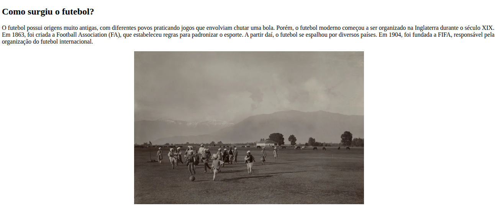
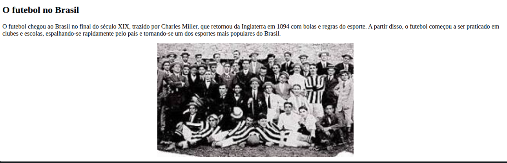

# Futebolisticos — Início do Futebol ⚽

Este repositório apresenta a página **Início do Futebol**, desenvolvida por **Ayumi** como parte do projeto acadêmico **Futebolisticos**, realizado durante o curso de **Análise e Desenvolvimento de Sistemas (ADS)**.

O projeto completo foi dividido entre os integrantes da turma, com cada pessoa responsável por um tema relacionado ao futebol. Esta página reúne informações sobre as origens do esporte e sua chegada ao Brasil.

---

## 📖 Conteúdo da página

- **Como surgiu o futebol?** — Um resumo das origens do futebol moderno e de sua organização na Inglaterra.
- **O futebol no mundo** — A expansão do esporte e sua popularização em diferentes países.
- **O futebol no Brasil** — A chegada do futebol ao país e o início de sua difusão.

## 📸 Capturas de tela

### Como surgiu o futebol?

### O futebol no Brasil

---

## 🎓 Sobre o projeto

A página possui uma **barra de navegação simulando o menu do site completo**. Como os demais temas ficaram com outros integrantes do grupo, alguns links são apenas ilustrativos e ainda não levam às páginas correspondentes nesta versão individual.

Atividade acadêmica do curso de **Análise e Desenvolvimento de Sistemas (ADS)**, desenvolvida para praticar a criação de páginas web em HTML.
